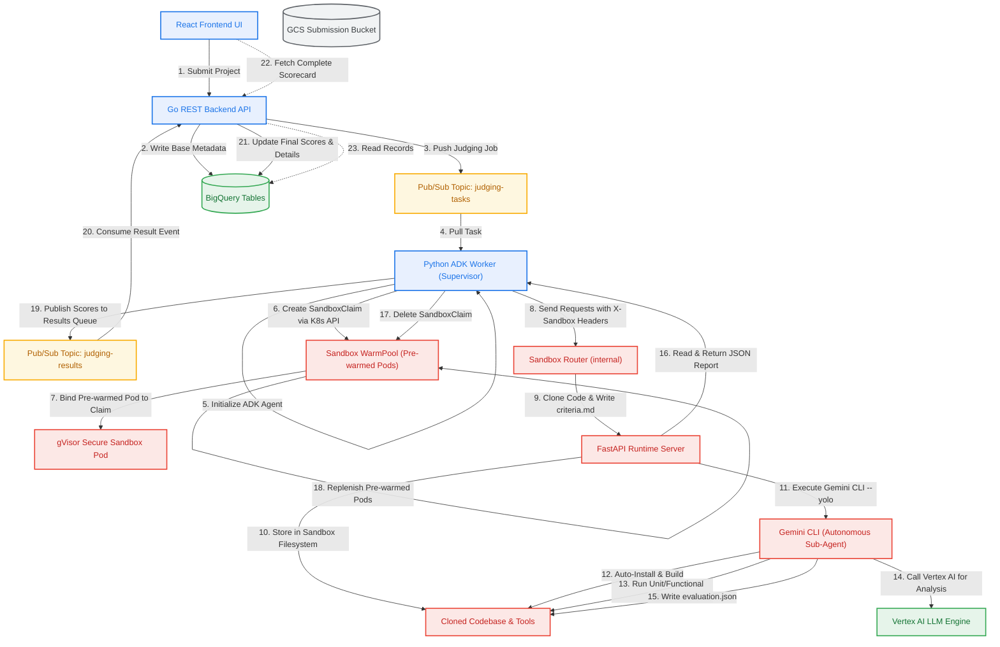

# Deploy Hackathon Judge with Agent Sandbox on GKE

## Introduction
Duration: 02:00

In this codelab, you will deploy the Hackathon Judge application on Google Kubernetes Engine (GKE) and use the Kubernetes-sigs Agent Sandbox to run agentic workloads safely and securely.

The platform is designed to automate the process of reviewing, testing, and grading hackathon projects using LLM agents. Since judging requires evaluating untrusted participant code submissions, a secure execution sandbox is critical to prevent code injection, privilege escalation, or resource abuse.

### What you'll do
- Provision the target Google Cloud services and establish target APIs.
- Initialize GKE Autopilot and install the Agent Sandbox CRDs, cluster configurations, and the Sandbox Router.
- Apply the Sandbox Network Policy, Sandbox Template, and a Sandbox WarmPool.
- Deploy the REST Backend API, ADK Judging worker Agent, and React Frontend UI.
- Wire external load-balanced routing and access the platform to run secure, sandboxed judging workflows.

### What you'll need
- A web browser such as [Chrome](https://www.google.com/chrome/).
- A Google Cloud project with billing enabled.

The resources created in this codelab should cost less than $5 in total runtime charges.

## Before You Begin
Duration: 05:00

### Start Cloud Shell
Click the button below to start Google Cloud Shell, which comes pre-configured with the required developer and cloud command-line utilities.

<button>[Start Cloud Shell](https://console.cloud.google.com/?cloudshell=true)</button>

### Enable APIs
Run the following command in Cloud Shell to enable all target Google Cloud APIs required to run the platform:

```bash
gcloud services enable \
  container.googleapis.com \
  artifactregistry.googleapis.com \
  cloudbuild.googleapis.com \
  pubsub.googleapis.com \
  aiplatform.googleapis.com \
  cloudresourcemanager.googleapis.com \
  iam.googleapis.com \
  bigquery.googleapis.com \
  bigqueryconnection.googleapis.com
```

> **Why we enable these APIs:**
> Google Cloud services are disabled by default to prevent unauthorized access and charges. We enable these specific APIs to activate container orchestration (GKE), secure container storage (Artifact Registry), serverless build packaging (Cloud Build), reliable messaging queues (Pub/Sub), AI model services (Vertex AI), project configuration (Cloud Resource Manager & IAM), serverless data analytics (BigQuery), and database-level AI bindings (BigQuery Connection).

## Set up Infrastructure
Duration: 15:00

In this step, you will clone the code repository and execute the automated setup script to deploy target cloud architecture and baseline cluster components.

### Clone the Repository
Clone the repository containing all the application services, setup scripts, and Kubernetes manifest declarations:

```bash
git clone https://github.com/moficodes/hackathon-judge
cd hackathon-judge
```

### Run Deployment Script
The foundational setup of your cloud resources, database models, and baseline Kubernetes cluster policies is automated by the `deploy.sh` script.

Run the script:

```bash
./deploy.sh
```

Follow the interactive shell prompts to supply configurations like your active Project ID and Target Region. The script automatically generates a local `.env` configuration, binds resources, compiles container images, and registers GKE baseline infrastructure.

Here are the target operations performed by the script:

#### 1. Environment Configuration Setup
The script creates a `.env` configuration file to store GKE, Pub/Sub, BigQuery, and project variable parameters. Sourcing this file dynamically populates all subsequent Kubernetes manifest definitions.
> **Why we configure this environment file:**
> The `.env` file centralizes configuration parameters, ensuring that the GKE manifests we apply manually in subsequent steps use identical regional settings, project names, and resources, strictly decoupling environmental configuration from source code.

#### 2. Google Cloud CLI & Target Project Configuration
The script verifies that `gcloud`, `bq`, `kubectl`, and `envsubst` utilities are installed, checks authentication state, and locks active configuration targets onto your active Google Cloud project.
> **Why we target the active project:**
> Setting the active target project prevents CLI commands from affecting other projects in your account and performs pre-flight authentication checks, ensuring that setup commands do not fail mid-deployment due to invalid credentials.

#### 3. Enabling Target Google Cloud APIs
The script performs an idempotent check to verify and enable the target Google Cloud service APIs (GKE, Artifact Registry, Cloud Build, Pub/Sub, Vertex AI, BigQuery, and IAM).
> **Why we enable Google Cloud APIs:**
> Managed cloud services must be activated before their endpoints are reachable or resources can be created. Enabling them at the start prepares the regional GCP API gateway to handle subsequent resource provisioning commands.

#### 4. Provisioning the Artifact Registry Docker Repository
The script provisions a Docker container repository named `hackathon-judge-repo` in the selected target location.
> **Why we create an Artifact Registry repository:**
> GKE clusters require secure access to private container registries in the same regional network to pull application images quickly. Artifact Registry provides a secure, private host to catalog, scan, and store Docker container images.

#### 5. Provisioning the GKE Autopilot Cluster
The script provisions a Google Kubernetes Engine (GKE) Autopilot cluster named `hackathon-judge-cluster`.
> **Why we deploy a GKE Autopilot cluster:**
> GKE Autopilot manages node provisioning, scaling, health monitoring, and host OS security upgrades automatically. It provides a production-grade container platform to orchestrate our persistent services and dynamically schedules secure worker sandboxes on-demand.

#### 6. Configuring Pub/Sub Topics and Subscriptions
The script provisions the message topics (`judging-tasks` and `judging-results`) along with their corresponding worker and API subscriptions.
> **Why we deploy Pub/Sub topics and subscriptions:**
> Evaluating code submissions is slow and resource-intensive. Using a message-queue architecture decouples the synchronous user-facing API from worker nodes. The API backend pushes jobs to the `judging-tasks` topic, and worker agents pull tasks as they are available, preventing API blocking and providing automatic retry capabilities.

#### 7. Configuring BigQuery Datasets, Tables, and AI Connections
The script creates the `hackathon_judge` dataset, applies structural SQL database schemas, loads seed records, and grants required AI and storage roles to the BigQuery ML connection service account.

#### 8. Triggering Container Builds using Cloud Build
The script triggers the `cloudbuild.yaml` definition to compile our React UI, Go REST server, Python ADK worker, and FastAPI sandbox, packaging them into isolated container images tagged with the active repository Git commit SHA and saving them to Artifact Registry.

#### 9. Registering Agent Sandbox Custom Resource Definitions (CRDs)
The script installs a pinned release (`v1.0.4`) of the Kubernetes-sigs Agent Sandbox controller and Custom Resource Definitions (`sandbox.yaml` and `extensions.yaml`) to extend GKE's core capabilities.
> **Why we install the Agent Sandbox infrastructure:**
> Standard Kubernetes clusters lack support for allocating protected on-demand sandboxes. Registering Agent Sandbox CRDs extends GKE's control plane, enabling Kubernetes to natively orchestrate secure sandboxed micro-containers using Custom Resources (like SandboxTemplates and SandboxClaims).

#### 10. Configuring Namespaces, Service Accounts, and Workload Identity
The script provisions the `hackathon-judge` namespace, registers Kubernetes Service Accounts (KSAs), and establishes Workload Identity mappings to grant GKE pods target Google Cloud permissions.

#### 11. Deploying the Sandbox Router
The script applies the `k8s/sandbox_router.yaml` manifest, deploying the upstream Sandbox Router into the `agent-sandbox-system` namespace and waiting for it to become healthy.
> **Why we deploy the Sandbox Router:**
> The Sandbox Router is a small internal reverse proxy. The worker agent sends each request to the router with headers identifying the target sandbox, and the router forwards it to the right sandbox pod. It is only reachable from inside the cluster: sandbox pods accept traffic from the router and nothing else.

---

## Configure Agent Sandbox Network Policy, Template, and WarmPool
Duration: 05:00

In this step, you will lock down sandbox networking, register the Sandbox Template, and deploy the Sandbox WarmPool to enable ultra-low latency sandboxing.

### Source Environment Variables
Before applying templates that require environment variables, source the `setup-env.sh` script to parse and export all necessary variables to your shell:

```bash
source ./setup-env.sh
```

### Apply Sandbox Network Policy
Restrict what sandbox pods can talk to:

```bash
kubectl apply -f k8s/sandbox-networkpolicy.yaml
```

> **Why we apply a Sandbox Network Policy:**
> Sandboxes run untrusted code. This policy only lets the Sandbox Router connect in, and only lets sandboxes connect out to cluster DNS, the GKE metadata server (for Workload Identity) and the public internet. They cannot reach other pods or private IPs in your VPC.
>
> Allowing the metadata server is a deliberate trade-off: the code being judged could also use the sandbox's identity. That is why the sandbox service account is only granted `roles/aiplatform.user`.

### Apply Sandbox Claim Template
Use `envsubst` to populate the sandbox template definition with your active environment variables, and apply it:

```bash
source ./setup-env.sh
envsubst < k8s/sandbox-claim-template.yaml | kubectl apply -f -
```

> **Why we deploy the Sandbox Claim Template:**
> The Sandbox Claim Template acts as the blueprint configuration defining the environment. It specifies the container image to run (pre-packaged with developer tools), environment parameters (GCP Project ID), ports, and resource limits (CPU/Memory targets). It configures GKE to run these container instances utilizing **gVisor (gvisor runtime)**, guaranteeing that untrusted participant code runs under an extra layer of kernel virtualization isolation.

### Apply Sandbox WarmPool
Apply the Sandbox WarmPool to pre-initialize running sandboxes:

```bash
kubectl apply -f k8s/sandbox-warmpool.yaml
```

Verify that the warm pool standby instances have started successfully:

```bash
kubectl get pods -n hackathon-judge -l app=sandbox
```

> **Why we deploy the Sandbox WarmPool:**
> Provisioning, scheduling, pulling images, and booting fresh container pods on-demand introduces substantial startup overhead (cold start times of 30+ seconds). The Sandbox WarmPool maintains a standby pool of active, pre-warmed sandbox pods (5 replicas by default). When the worker agent claims an evaluation environment, the Agent Sandbox controller binds the claim to a running pre-warmed pod, cutting start-up delays to sub-second speeds.

---

## Deploy Application Components
Duration: 05:00

With the secure sandboxing infrastructure fully active, you will now deploy the central backend API, worker agent, React web interface, and the ingress Gateway mapping.

### Deploy Backend
Deploy the orchestrator REST API backend:

```bash
source ./setup-env.sh
envsubst < k8s/backend.yaml | kubectl apply -f -
```

### Deploy Agent
Deploy the ADK judging worker agent:

```bash
source ./setup-env.sh
envsubst < k8s/agent.yaml | kubectl apply -f -
```

### Deploy Frontend
Deploy the interactive web user interface:

```bash
source ./setup-env.sh
envsubst < k8s/frontend.yaml | kubectl apply -f -
```

### Configure external Gateway and Routing
Deploy the main Gateway and ingress HTTP routes mapping external client traffic:

```bash
kubectl apply -f k8s/gateway.yaml
```

> **Why we deploy the External Ingress Gateway:**
> The external Gateway exposes our services using the Kubernetes Gateway API. It provisions a load-balanced public IP address and maps routes based on path rules—directing API requests under `/api/*` to the Go Backend, and mapping all other client web traffic (`/`) to the React Frontend, securing public cluster access.

### Verify Rollouts
Block shell execution and wait until all three core service deployments have reached a healthy, ready rollout status:

```bash
kubectl rollout status deployment/backend -n hackathon-judge --timeout=300s
kubectl rollout status deployment/agent -n hackathon-judge --timeout=300s
kubectl rollout status deployment/frontend -n hackathon-judge --timeout=300s
```

---

## Verify and Use the Application
Duration: 05:00

### Access the UI
Fetch the external public IP address of the newly provisioned main load balancer gateway:

```bash
kubectl get gateway -n hackathon-judge hackathon-judge-gateway
```

> **Why we get the Gateway status:**
> The Gateway API handles public ingress. Checking the Gateway status returns the public, load-balanced external IP address allocated by Google Cloud's external global load balancer to our cluster, which represents the public address of our platform.

Open the displayed public IP address in your browser.

### Submit Tasks
Use the frontend UI to add a team, configure evaluation parameters, and submit a project task for grading.

### Watch Sandbox Kickoff
Monitor the active pods inside the `hackathon-judge` namespace to see a sandbox pod dynamically claimed and provisioned for judging execution:

```bash
kubectl get pods -n hackathon-judge -w
```

Check the logs of the worker agent pod to witness the step-by-step ADK judging evaluation logic:

```bash
kubectl logs -l app=agent -n hackathon-judge
```

> **Why we inspect Agent logs:**
> Inspecting worker agent logs displays the detailed internal steps of the evaluation pipeline in real-time. You can trace the ADK agent fetching the task, requesting a sandbox container, executing compilation targets, analyzing reports with Gemini, and publishing scorecards.

---

## How it Works
Duration: 10:00

The Hackathon Judge application uses two distinct paradigms to evaluate submitted projects safely, objectively, and at scale:

1. **BigQuery AI Functions**: A serverless, database-driven pipeline that uses SQL commands to query, summarize, and score project assets stored in Google Cloud Storage directly inside your data warehouse.
2. **GKE Agent Sandbox (gVisor)**: An event-driven container pipeline that schedules untrusted participant code in isolated, virtualized sandboxes on Google Kubernetes Engine, running tests and static analysis dynamically.

---

### BigQuery AI Functions

By integrating BigQuery with Vertex AI models using a **Cloud Resource Connection**, you can score and analyze files (like markdown READMEs or project logs) straight from your database tables using familiar SQL commands. This approach eliminates complex external ETL pipelines, text parsers, and custom model endpoints.

Here are the primary SQL and infrastructure operations that make BigQuery AI functions work:

#### 1. Establishing the BigQuery Cloud Connection & Permissions
To connect BigQuery to external Vertex AI and storage resources, we create a connection resource and grant its background principal appropriate IAM roles:

```sql
-- Create a Connection Resource in BigQuery
CREATE CONNECTION IF NOT EXISTS `<<REGION>>.connection-resource`
OPTIONS (
  connection_type = 'CLOUD_RESOURCE'
);
```

> aside positive
> When this query runs, Google Cloud provisions a virtual backend Service Account (Service Principal) for the connection. During deployment, the `deploy.sh` script automatically grants this principal:
> - `roles/aiplatform.user` to make predictions via Vertex AI APIs (Gemini models).
> - `roles/storage.objectViewer` to securely read files stored in GCS buckets on-demand.

#### 2. Registering External GCS Files as Database Tables
To access raw submission files in the database, we define an external object table pointing to our target Google Cloud Storage bucket paths:

```sql
-- Create an External Object Table pointing to your GCS submission bucket
CREATE EXTERNAL TABLE IF NOT EXISTS `submissions_objects`
WITH CONNECTION `<<REGION>>.connection-resource`
OPTIONS (
  object_metadata = 'SIMPLE',
  uris = ['gs://<<YOUR PROJECT ID>>-stabby/*']
);
```

#### 3. Executing In-Database LLM Summaries and Scoring
Once the connection and tables are active, we can run real-time multimodal LLM tasks directly on raw files using high-level SQL AI functions:

```sql
-- In-database evaluation using AI.SCORE and AI.GENERATE
SELECT ref.uri,
AI.SCORE(
  prompt => ('Rate this project based on the documentation quality on a scale of 0 to 100. Good quality includes clarity, completeness, and organization. Also images and possibly videos', 
  OBJ.GET_ACCESS_URL(ref, 'r'))
),
AI.GENERATE(
  prompt => ('Summarize this project', 
  OBJ.GET_ACCESS_URL(ref, 'r'))
).result as summary
FROM `submissions_objects`
WHERE uri LIKE ('%README%')
```

Let's break down how this works:
* **`AI.SCORE` & `AI.GENERATE`**: Built-in BigQuery ML functions that abstract LLM declarations. They communicate directly with Vertex AI models (like Gemini) to return structured text or numbers.
* **`OBJ.GET_ACCESS_URL(ref, 'r')`**: Generates a temporary, secure, read-only access URL for the targeted file in the external GCS table, passing the GCS data stream straight to the Gemini model as multimodal context along with the prompt!

#### 4. The Complete In-Database Judging Query (`batch_scoring.sql`)
For multi-category evaluations, the Go backend runs a single composite query that flattens a hackathon's criteria rules, queries the target README, scores each category, and inserts the final evaluation:

```sql
INSERT INTO `hackathon_judge.evaluations` (id, project_id, judge_id, status, criteria_json, total_score, comment, created_at)
WITH ProjectInfo AS (
  SELECT p.id, p.readme_ref, p.hackathon_id
  FROM `hackathon_judge.projects` p
  WHERE p.id = @project_id
),
CriteriaToScore AS (
  SELECT c.id, c.name, c.description, c.max_score, c.weight
  FROM `hackathon_judge.hackathons` h, UNNEST(h.criteria) c
  JOIN ProjectInfo pi ON h.id = pi.hackathon_id
),
Scored AS (
  SELECT
    id, name, description, weight, max_score,
    AI.SCORE(
      prompt => (description, OBJ.GET_ACCESS_URL((SELECT readme_ref FROM ProjectInfo), 'r'))
    ) as score
  FROM CriteriaToScore
),
NewEval AS (
  SELECT
    GENERATE_UUID() as id,
    (SELECT id FROM ProjectInfo) as project_id,
    'BQ_JUDGE' as judge_id,
    'COMPLETED' as status,
    ARRAY(SELECT AS STRUCT name, description, weight, score, max_score FROM Scored) as criteria_json,
    (SELECT SUM(score) FROM Scored) as total_score,
    'Automated evaluation' as comment,
    CURRENT_TIMESTAMP() as created_at
)
SELECT * FROM NewEval;
```

This advanced query performs the following operations:
1. **`ProjectInfo` CTE**: Identifies the target project and grabs its Cloud Storage README pointer (`readme_ref`).
2. **`CriteriaToScore` CTE**: Flattens the nested criteria array of the corresponding hackathon using standard SQL **`UNNEST`**, matching specific descriptions, weights, and max scores.
3. **`Scored` CTE**: Triggers parallel `AI.SCORE` pipelines for each criteria row, passing the README stream as model context.
4. **`NewEval` CTE**: Packages the results back into a nested array of structs (`criteria_json`), sums up individual scores for the overall total, generates a unique evaluation UUID, and inserts it directly into the transactional database table.

---

### Agent Sandbox Architecture

While BigQuery AI functions are incredible for evaluating text-based submissions and README claims, judging an engineering project requires compiling code, installing third-party libraries, and running real test suites.

Running raw user code poses massive security risks, including host compromise, container breakouts, and unauthorized resource access. The **GKE Agent Sandbox** framework mitigates these risks by orchestrating isolated sandbox workloads using **gVisor (runsc) virtualization**.

#### System Interaction Flow

The diagram below maps how the various elements of our event-driven system communicate during a secure sandboxed judging execution:



#### How the Engaged Tools and Components Work Together

* **React Frontend UI**: Exposes an interactive interface where users configure criteria models, register teams, submit project URLs, and review finalized grading scorecards, including full file discrepancies and engineering comments.
* **Go REST Backend API**: Manages global API endpoints. It stores project configurations in BigQuery and pushes judging jobs to Pub/Sub to decouple heavy computational execution pipelines.
* **Google Pub/Sub**: The message-oriented broker that holds task messages safely on-queue, orchestrating communication asynchronously between the API and active worker instances.
* **Python ADK Worker (Supervisor Agent)**: A background worker that pulls tasks from Pub/Sub. It leverages the **Google Agent Development Kit (ADK)** to start a high-level supervisor agent, which is instructed to orchestrate the evaluation. The supervisor invokes its primary tool, `evaluate_repository`, to delegate deep raw command testing.
* **Sandbox Router (internal)**: A stateless reverse proxy in the `agent-sandbox-system` namespace. The worker agent claims a sandbox from the WarmPool through the Kubernetes API, then sends commands and file operations to the router, which forwards them to that sandbox pod. There is no public endpoint.
* **Sandbox WarmPool**: To avoid long GKE container startup times ("cold starts" of 30+ seconds), the WarmPool maintains active standby pods. When the worker creates a SandboxClaim, the Agent Sandbox controller binds it to a pre-warmed pod in sub-second time, and refills the pool after the claim is deleted.
* **gVisor (runsc) Isolation**: A user-space virtual kernel that acts as a secure sandboxing boundary. It intercepts system calls from the container space to GKE node kernels, ensuring that dangerous raw commands (like system scripts or package setups) run under absolute virtualization isolation.
* **FastAPI Sandbox Runtime**: A lightweight Python API server running inside the sandbox container. It exposes secure endpoints (`/execute`, `/upload`, `/download`) that allow external worker tools to manipulate files and trigger shell tasks.
* **Gemini CLI (`@google/gemini-cli`)**: An autonomous agent script installed inside the sandbox. When triggered with the developer environment runtime flag (`--yolo`), it uses a rigorous grading instruction sheet (`prompt.md`) and criteria definition (`criteria.md`) to:
  - Dynamically analyze the codebase hierarchy (using tools like `tree` or `ripgrep`).
  - Automatically install requirements (via commands like `npm install`, `pip install`, `go build`).
  - Run real development tests (such as `npm test` or `pytest`) to verify functionality.
  - Call Vertex AI models (via the container's Workload Identity binding credentials) to evaluate file logic, cross-check claims against the README, detect ghost features, log quality issues, and write a structured scorecard report to `evaluation.json`.
* **Standard Developer Environments**: Bundles node, npm, yarn, pnpm, python, pip, uv, go, gh, git, tree, ripgrep, and playwright in the sandbox container image, giving the autonomous sub-agent a complete test workspace.

> aside positive
> **Workload Identity security in action:**
> Notice how the sandbox GKE Service Account (`hackathon-judge-sandbox-sa`) was granted the standard `roles/aiplatform.user` IAM permission during infrastructure setup. When the Gemini CLI inside the sandbox pod requests model responses from Vertex AI, GKE's Workload Identity automates key generation and credentials-checking under the hood! The container never stores static API keys or hardcoded cloud credentials, maintaining top-tier security guidelines automatically.

---

## Clean Up
Duration: 03:00

To avoid ongoing charges to your Google Cloud account, delete the resources created during this codelab.

```bash
./destroy.sh
```

> **Why we clean up resources:**
> Google Cloud bills on a resource utilization model. Active resources like GKE Autopilot clusters, network load balancers, and persistent disks incur ongoing charges even when they are idle. Running this step deletes the cluster namespace to clear Kubernetes objects, and deletes the GKE Autopilot cluster host itself to immediately terminate all underlying billing charges.

---

## Congratulations
Duration: 01:00

Congratulations! You have successfully deployed the Hackathon Judge application with Agent Sandbox on GKE!

You have implemented a secure, modern event-driven AI platform capable of testing and evaluating untrusted codebase submissions under isolated containerized security constraints.

### What you've learned
- **GKE Infrastructure**: How to provision GKE Autopilot and supporting Google Cloud services like Pub/Sub and BigQuery.
- **Agent Sandbox Configuration**: How to configure Custom Resource Definitions, SandboxTemplates, SandboxClaims, and high-performance Sandbox WarmPools.
- **Microservices Deployment**: How to configure Workload Identity bindings and deploy a multi-component microservices architecture (Frontend React, REST Go, Worker ADK Agent, and Isolated Sandbox).
- **Secure Sandboxing**: How to utilize gVisor virtualized containers to run untrusted third-party commands securely on GKE nodes.

### Next steps
- Explore the [Agent Sandbox documentation](https://agent-sandbox.sigs.k8s.io/).
- Learn more about [GKE Autopilot features](https://cloud.google.com/kubernetes-engine/docs/concepts/autopilot-overview).
- Check out the [Agent Platform Documentation](https://docs.cloud.google.com/gemini-enterprise-agent-platform).

### Reference docs
- [Kubernetes Gateway API Specification](https://gateway-api.sigs.k8s.io/)
- [gVisor Sandboxing Runtime](https://gvisor.dev/)

