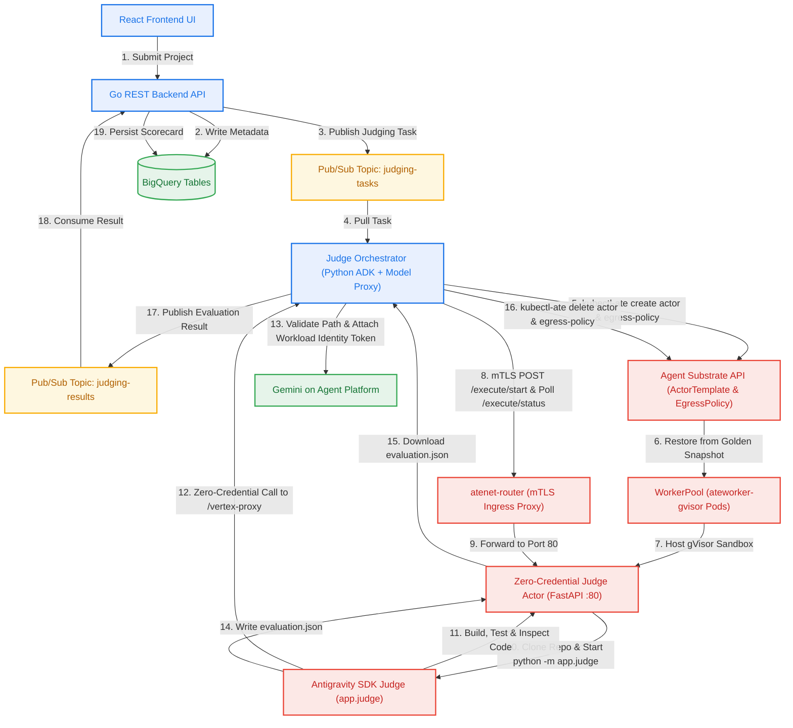

# Deploy Hackathon Judge with Agent Substrate on GKE

## Introduction
Duration: 02:00

In this codelab, you will deploy the Hackathon Judge application on Google Kubernetes Engine (GKE) and use **Agent Substrate** (`v1.0.0`) to run untrusted code evaluation workloads safely and at low latency.

The platform automates the process of reviewing, testing, and grading hackathon projects using AI agents. Since judging requires cloning, building, and testing untrusted participant code submissions, each evaluation runs inside an ephemeral, zero-credential **Judge Actor** restored from a memory-fidelity **Golden Snapshot** inside a gVisor sandbox.

### What you'll do
- Provision the target Google Cloud services and enable required APIs.
- Provision a GKE Standard cluster with gVisor sandbox nodes and install **Agent Substrate** (`v1.0.0`) and `kubectl-ate`.
- Configure the Agent Substrate **WorkerPool** (`judge-workerpool`), **AccessPolicy**, and **ActorTemplate** (`judge-sandbox`) to create a pre-initialized **Golden Snapshot**.
- Deploy the REST Backend API, the ADK **Judge Orchestrator** (`agent`) with its internal **Model Proxy**, and the React Frontend UI.
- Wire external load-balanced routing and watch ephemeral **Judge Actors** and per-actor **EgressPolicy** rules run evaluations through `atenet-router`.

### What you'll need
- A web browser such as [Chrome](https://www.google.com/chrome/).
- A Google Cloud project with billing enabled.

The resources created in this codelab should cost less than \$5 in total runtime charges.

## Before You Begin
Duration: 05:00

### Start Cloud Shell
Click the button below to start Google Cloud Shell, which comes pre-configured with the required developer and cloud command-line utilities.

<button>[Start Cloud Shell](https://console.cloud.google.com/?cloudshell=true)</button>

### Enable APIs
Run the following command in Cloud Shell to enable all target Google Cloud APIs required to run the platform:

```bash
gcloud services enable \
  container.googleapis.com \
  generativelanguage.googleapis.com \
  artifactregistry.googleapis.com \
  cloudbuild.googleapis.com \
  pubsub.googleapis.com \
  aiplatform.googleapis.com \
  cloudresourcemanager.googleapis.com \
  iam.googleapis.com \
  bigquery.googleapis.com \
  bigqueryconnection.googleapis.com \
  storage.googleapis.com
```

> **Why we enable these APIs:**
> Google Cloud services are disabled by default to prevent unauthorized access and charges. We enable these specific APIs to activate container orchestration (GKE), secure container storage (Artifact Registry), serverless build packaging (Cloud Build), reliable messaging queues (Pub/Sub), AI model services (**Gemini Enterprise Agent Platform**), project configuration (Cloud Resource Manager & IAM), serverless data analytics (BigQuery), database-level AI bindings (BigQuery Connection), and snapshot object storage (Cloud Storage).

## Set up Infrastructure
Duration: 15:00

In this step, you will clone the code repository and execute the automated setup script to deploy the target cloud architecture and Agent Substrate baseline components.

### Clone the Repository
Clone the repository containing all the application services, setup scripts, and Kubernetes manifest declarations:

```bash
git clone https://github.com/moficodes/hackathon-judge
cd hackathon-judge
```

### Run Deployment Script
The foundational setup of your cloud resources, database models, GKE cluster, and Agent Substrate control plane is automated by the `deploy.sh` script.

Run the script:

```bash
./deploy.sh
```

Follow the interactive shell prompts to supply configurations like your active Project ID and Target Region. The script automatically generates a local `.env` configuration, binds resources, compiles container images, and installs Agent Substrate (`v1.0.0`).

Here are the target operations performed by the script:

#### 1. Environment Configuration Setup
The script creates a `.env` configuration file to store GKE, Pub/Sub, BigQuery, and project variable parameters. Sourcing this file dynamically populates all subsequent Kubernetes and Agent Substrate manifest definitions.
> **Why we configure this environment file:**
> The `.env` file centralizes configuration parameters, ensuring that the GKE and Agent Substrate manifests we apply use identical regional settings, project names, and image tags, strictly decoupling environmental configuration from source code.

#### 2. Google Cloud CLI & Target Project Configuration
The script verifies that `gcloud`, `bq`, `kubectl`, and `envsubst` utilities are installed, checks authentication state, and locks active configuration targets onto your active Google Cloud project.

#### 3. Enabling Target Google Cloud APIs
The script performs an idempotent check to verify and enable the target Google Cloud service APIs (GKE, Artifact Registry, Cloud Build, Pub/Sub, Gemini Enterprise Agent Platform, BigQuery, Cloud Storage, and IAM).

#### 4. Provisioning the Artifact Registry Docker Repository
The script provisions a Docker container repository named `hackathon-judge-repo` in the selected target location.

#### 5. Provisioning the GKE Standard Cluster with gVisor
The script provisions a Google Kubernetes Engine (GKE) Standard cluster named `hackathon-judge-cluster` (`c3-standard-4` nodes on the `rapid` release channel with `--sandbox="type=gvisor"` and Workload Identity enabled).
> **Why we deploy a GKE Standard cluster with gVisor:**
> Agent Substrate hosts multiple isolated gVisor actor sandboxes inside long-running `ateworker-gvisor` worker pods managed by a `WorkerPool` and node-level `atelet` DaemonSet, providing sub-second snapshot restore times with strong kernel-level syscall isolation.

#### 6. Configuring Pub/Sub Topics and Subscriptions
The script provisions the message topics (`judging-tasks` and `judging-results`) along with their corresponding worker and API subscriptions.

#### 7. Configuring BigQuery Datasets, Tables, and AI Connections
The script creates the `hackathon_judge` dataset, applies structural SQL database schemas, and loads seed records.

#### 8. Triggering Container Builds using Cloud Build
The script triggers `cloudbuild.yaml` to compile our React UI, Go REST server, Python ADK **Judge Orchestrator** (`agent`, which includes `kubectl-ate` `v1.0.0`), and FastAPI **Judge Actor** runtime (`agent-sandbox`), packaging them into container images tagged with the active Git commit SHA.

#### 9. Installing Agent Substrate (`v1.0.0`) and `kubectl-ate`
The script creates the Cloud Storage snapshot buckets (`<PROJECT_ID>-ate-snapshots` and `<PROJECT_ID>-ate-snapshots-assets`) and the `ate-snapshot-transfer` service account, builds `kubectl-ate` `v1.0.0`, and runs `ate-setup deploy ate-system` to deploy the Agent Substrate control plane (`ate-api-server`, `atenet-router`, `atenet-egress`, `ate-snapshot-controller`, and `ds/atelet`). It configures `--ingress-allowed-spiffe-ids=spiffe://cluster.local/ns/hackathon-judge/sa/hackathon-judge-sa` on `atenet-router` so the Judge Orchestrator can route mTLS requests to Judge Actors.

#### 10. Configuring Namespaces, Service Accounts, and Workload Identity
The script applies `k8s/namespace.yaml` (labeling `hackathon-judge` with `ate.dev/api-access: "true"`), registers the `hackathon-judge-sa` Kubernetes Service Account (`k8s/service-account.yaml`), and binds Workload Identity roles (`roles/bigquery.dataEditor`, `roles/bigquery.jobUser`, `roles/pubsub.publisher`, `roles/pubsub.subscriber`, and `roles/aiplatform.user`) strictly to `hackathon-judge-sa`. Judge Actors run with zero credentials and no sandbox service account.

---

## Configure Agent Substrate WorkerPool, AccessPolicy, and ActorTemplate
Duration: 05:00

In this step, you will verify or apply the Agent Substrate **WorkerPool**, **AccessPolicy**, and **ActorTemplate** (**Golden Snapshot**) that power instant, isolated evaluations.

### Source Environment Variables
Before applying templates that require environment variables, source the `setup-env.sh` script to parse and export all necessary variables to your shell:

```bash
source ./setup-env.sh
```

### Apply WorkerPool (`k8s/substrate.yaml`)
Apply the `WorkerPool` resource (`judge-workerpool`), which maintains 3 `ateworker-gvisor` worker pods in the `hackathon-judge` namespace:

```bash
envsubst < k8s/substrate.yaml | kubectl apply -f -
```

> **Why we configure `4608Mi` memory on the WorkerPool:**
> Each `ateworker-gvisor` pod reserves `64Mi` of overhead from its container memory limit (`limits.memory`). Configuring `4608Mi` (`4.5 GiB`) on the `WorkerPool` pod guarantees at least `4096Mi` (`4 GiB`) of allocatable memory so every `4 GiB` Judge Actor schedules cleanly.

### Create Atespace & Apply AccessPolicy (`k8s/access-policy.yaml`)
Create the `hackathon-judge` atespace and grant the Judge Orchestrator service account (`hackathon-judge-sa`) OpenFGA `editor` permissions:

```bash
kubectl-ate create atespace hackathon-judge 2>/dev/null || true
kubectl-ate create access-policy -a hackathon-judge -f k8s/access-policy.yaml
```

### Apply ActorTemplate (`k8s/actortemplate.yaml`)
Register the `judge-sandbox` `ActorTemplate` to build the memory-fidelity **Golden Snapshot** (`SNAPSHOT_FIDELITY_MEMORY`):

```bash
envsubst < k8s/actortemplate.yaml | kubectl-ate create actor-template -f -
```

> **Why we use an ActorTemplate and Golden Snapshot:**
> When `judge-sandbox` is created, Agent Substrate boots a builder actor from the `agent-sandbox` container image, waits for its `/health` wakeup probe on port `80` to return `200 OK`, and checkpoints its initialized gVisor memory and filesystem state to Cloud Storage (`status.goldenSnapshotStatus.snapshotTime`). Every subsequent **Judge Actor** restores directly from this **Golden Snapshot** in sub-second time and is deleted after a single evaluation so cross-submission state never leaks.

Verify that the worker pool pods are running and the `ActorTemplate` has produced its Golden Snapshot:

```bash
kubectl get pods -n hackathon-judge -l workload=hackathon-judge
kubectl-ate get actor-template judge-sandbox -a hackathon-judge
```

---

## Deploy Application Components
Duration: 05:00

With the Agent Substrate `WorkerPool` and `ActorTemplate` Golden Snapshot active, deploy the backend API, Judge Orchestrator (`agent`), React web interface, and external Gateway.

### Deploy Backend
Deploy the REST API backend:

```bash
source ./setup-env.sh
envsubst < k8s/backend.yaml | kubectl apply -f -
```

### Deploy Judge Orchestrator (`agent`)
Deploy the ADK Judge Orchestrator and its internal `Service/agent` (`:8000` and `:8082`):

```bash
source ./setup-env.sh
envsubst < k8s/agent.yaml | kubectl apply -f -
```

> **Why `k8s/agent.yaml` mounts `router-client` and exposes `Service/agent`:**
> `Deployment/agent` mounts the projected `router-client` volume at `/run/router-client` containing an `api.ate-system.svc` audience token, the `servicedns.podcert.ate.dev/identity` trust bundle, and an ECDSA P-256 `podidentity.podcert.ate.dev/identity` client certificate so the orchestrator can dial `atenet-router` over mTLS. Meanwhile, `Service/agent` exposes the **Model Proxy** (`http://agent.hackathon-judge.svc.cluster.local:8000/vertex-proxy`) inside the cluster so zero-credential Judge Actors can make Gemini model calls through the orchestrator.

### Deploy Frontend
Deploy the interactive web user interface:

```bash
source ./setup-env.sh
envsubst < k8s/frontend.yaml | kubectl apply -f -
```

### Configure External Gateway and Routing
Deploy the main Gateway and ingress HTTP routes mapping external client traffic:

```bash
kubectl apply -f k8s/gateway.yaml
```

### Verify Rollouts
Wait until all three core service deployments have reached a healthy rollout status:

```bash
kubectl rollout status deployment/backend -n hackathon-judge --timeout=300s
kubectl rollout status deployment/agent -n hackathon-judge --timeout=300s
kubectl rollout status deployment/frontend -n hackathon-judge --timeout=300s
```

---

## Verify and Use the Application
Duration: 05:00

### Access the UI
Fetch the external public IP address of the load balancer gateway:

```bash
kubectl get gateway -n hackathon-judge hackathon-judge-gateway -w
```

When provisioned, you will see output similar to:

```console
NAME                      CLASS    ADDRESS          PROGRAMMED   AGE
hackathon-judge-gateway   gke-l7   34.120.120.120   True         3m
```

Open the allocated public IP address in your browser to load the Hackathon Judge dashboard.

### Submit Tasks & Watch Ephemeral Judge Actors
Use the frontend UI to submit a project repository for evaluation. When a **Judging Task** starts, the Judge Orchestrator creates a fresh ephemeral **Judge Actor** (`judge-<uuid>`) from the `judge-sandbox` **ActorTemplate** and attaches a per-actor **EgressPolicy**. Watch the actors in real time:

```bash
kubectl-ate get actors -a hackathon-judge
```

Inspect the Judge Orchestrator logs to trace the evaluation lifecycle:

```bash
kubectl logs -l app=agent -n hackathon-judge -f
```

> **Why we inspect Judge Orchestrator logs:**
> You can trace the ADK agent pulling the task from Pub/Sub, creating `judge-<uuid>` and its `EgressPolicy` via `kubectl-ate`, starting asynchronous commands (`POST /execute/start`) and polling `GET /execute/status/{job_id}` through `atenet-router`, proxying Gemini model calls via `/vertex-proxy`, reading `evaluation.json`, and deleting the Judge Actor in its `finally:` block.

---

## How it Works
Duration: 10:00

The Hackathon Judge application uses two complementary paradigms to evaluate submitted projects safely, objectively, and at scale:

1. **BigQuery AI Functions**: A serverless, database-driven pipeline that uses SQL commands to query, summarize, and score project assets directly inside BigQuery.
2. **Agent Substrate (`v1.0.0`) Ephemeral Judge Actors**: An event-driven container pipeline that restores zero-credential gVisor **Judge Actors** from a **Golden Snapshot** on GKE, running builds, tests, and static analysis dynamically.

---

### BigQuery AI Functions

By integrating BigQuery with **Gemini on Agent Platform** using a **Cloud Resource Connection**, you can score and analyze files (like markdown READMEs or project logs) straight from your database tables using standard SQL commands:

```sql
-- Create a Connection Resource in BigQuery
CREATE CONNECTION IF NOT EXISTS `<<REGION>>.connection-resource`
OPTIONS (
  connection_type = 'CLOUD_RESOURCE'
);
```

> aside positive
> When this query runs, Google Cloud provisions a virtual backend Service Principal for the connection. During deployment, the `deploy.sh` script grants this principal:
> - `roles/aiplatform.user` to invoke Gemini models on **Gemini Enterprise Agent Platform**.
> - `roles/storage.objectViewer` to read files stored in Cloud Storage buckets on-demand.

Once the connection and tables are active, the backend can run composite SQL queries using `AI.SCORE` and `AI.GENERATE` to evaluate documentation against hackathon rubric criteria.

---

### Agent Substrate Architecture

While BigQuery AI functions excel at evaluating README documentation, judging an engineering project requires cloning repositories, installing third-party dependencies, and running real test suites.

Running untrusted participant code poses severe security risks, including credential theft, container breakouts, and lateral movement. **Agent Substrate** (`v1.0.0`) eliminates these risks by running each evaluation inside a single-use gVisor **Judge Actor** with zero GCP credentials, governed by a strict **EgressPolicy** and mediated by `atenet-router` and the orchestrator's **Model Proxy**.

#### System Interaction Flow



#### How the Components Work Together

* **Judge Orchestrator (`agent`)**: Subscribes to `judging-tasks`, runs the ADK coordinator agent, manages the lifecycle of ephemeral **Judge Actors** via `kubectl-ate`, communicates with actors through `atenet-router` over mTLS using pod identity certificates (`/run/router-client`), and hosts the internal **Model Proxy** (`/vertex-proxy`).
* **WorkerPool (`judge-workerpool`) & ActorTemplate (`judge-sandbox`)**: The `WorkerPool` runs gVisor worker pods (`ateworker-gvisor`), while the `ActorTemplate` defines the **Golden Snapshot** (`SNAPSHOT_FIDELITY_MEMORY`) of the `agent-sandbox` container with `egress-mitm.ate.dev` and `system-roots.ate.dev` trust bundles pre-mounted.
* **`atenet-router` & Asynchronous Command Polling**: `atenet-router` routes mTLS requests from the Judge Orchestrator to the target Judge Actor using `X-Ate-Target-Atespace`, `X-Ate-Target-Actor`, and `X-Ate-Target-Port: 80` headers. Because repository cloning and LLM grading can take several minutes, the orchestrator starts commands asynchronously via `POST /execute/start` and polls `GET /execute/status/{job_id}` every 2 seconds so individual HTTP requests remain sub-second.
* **Per-Actor `EgressPolicy` & Zero-Credential Model Proxy**: Each Judge Actor runs with zero Google Cloud credentials and has no access to the GKE metadata server. Its `EgressPolicy` permits only outbound HTTPS (`:443`) to clone public repositories and download packages (inspected via `atenet-egress` MITM CA) plus HTTP (`:8000` / `:8082`) to `agent.hackathon-judge.svc.cluster.local`. When `app/judge.py` invokes the Antigravity SDK (`VertexEndpoint` pointed at `MODEL_PROXY_BASE_URL`), the Judge Orchestrator's `/vertex-proxy` validates that the path matches `^v1(beta1)?/projects/.../locations/.../publishers/google/models/...:(generateContent|streamGenerateContent)$` (rejecting any other path with `403 Forbidden`), attaches its own Workload Identity token, and streams the **Gemini on Agent Platform** response back to the actor.

---

## Clean Up
Duration: 03:00

To avoid ongoing charges to your Google Cloud account, delete the resources created during this codelab:

```bash
./destroy.sh
```

> **Why we clean up resources:**
> The `destroy.sh` script deletes the Pub/Sub topics and subscriptions, the GKE Standard cluster (including Agent Substrate, `WorkerPool` pods, and any Judge Actors), the Artifact Registry repository, the BigQuery dataset, the Agent Substrate Cloud Storage snapshot buckets (`<PROJECT_ID>-ate-snapshots` and `<PROJECT_ID>-ate-snapshots-assets`), and the `ate-snapshot-transfer` service account.

---

## Congratulations
Duration: 01:00

Congratulations! You have deployed the Hackathon Judge application with **Agent Substrate** (`v1.0.0`) on GKE!

### What you've learned
- **GKE & Agent Substrate Infrastructure**: How to provision a GKE Standard cluster with gVisor nodes and install Agent Substrate (`v1.0.0`) and `kubectl-ate`.
- **Golden Snapshots & Ephemeral Judge Actors**: How to define a `WorkerPool` and `ActorTemplate` (`SNAPSHOT_FIDELITY_MEMORY`) so every submission is graded in a fresh Judge Actor restored from a Golden Snapshot and deleted immediately after completion.
- **Zero-Credential Sandboxing & Model Proxy**: How to isolate untrusted code with zero cloud credentials, enforce per-actor `EgressPolicy` rules, and proxy strictly validated model calls through the Judge Orchestrator to **Gemini Enterprise Agent Platform**.
- **Resilient mTLS Actor Communication**: How to authenticate to `atenet-router` with projected pod identity certificates and use asynchronous `/execute/start` + `/execute/status/{job_id}` polling for long-running evaluations.

### Next steps
- Check out the [Gemini Enterprise Agent Platform Documentation](https://docs.cloud.google.com/gemini-enterprise-agent-platform).
- Learn more about [Kubernetes Gateway API](https://gateway-api.sigs.k8s.io/) and [gVisor Sandboxing Runtime](https://gvisor.dev/).
